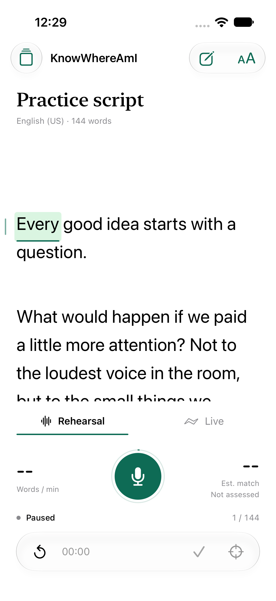
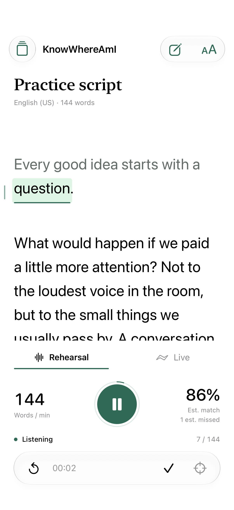
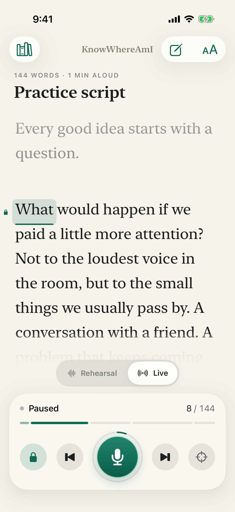
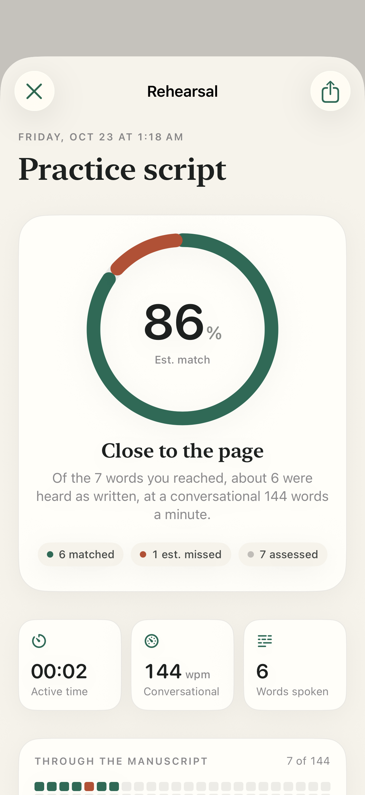

# KnowWhereAmI

A native English manuscript-following app for iPhone 17, built with SwiftUI and
Apple's on-device SpeechAnalyzer / SpeechTranscriber. Requires iOS 27.0+ and
Xcode 27. No third-party packages, account, analytics, or cloud transcription.

## Screenshots

| Reader | Rehearsing | Live | Rehearsal Report |
| --- | --- | --- | --- |
|  |  |  |  |

These are actual simulator screens captured by the `UI Screenshots` workflow
(iOS 26.5 simulator, no microphone). Rehearsing and the report use a controlled
test transcript, not a live microphone or an acoustic benchmark. The design
language is described in `docs/EXPERIENCE-UPGRADE.md`.

## Run On iPhone

1. Open `KnowWhereAmI.xcodeproj` in Xcode.
2. Select the `KnowWhereAmI` scheme and your connected, unlocked iPhone.
3. Select your development team in Signing & Capabilities. Enable Developer Mode
   on the iPhone if Xcode requests it, then run.
4. Open the library to add a script, edit the practice script, or import a
   UTF-8 / UTF-16 `.txt` or `.md` file.
5. Tap the microphone. The first session may need to download Apple's English
   speech assets. Allow microphone access when prompted.

The reading position follows speech, not a preset scrolling speed. Yellow
highlighting is provisional; green indicates a finalized or manually selected
position. The current line stays at a fixed focus lane with interruptible,
critically damped scrolling. Reduced Motion disables animated travel. Manual
scrolling temporarily suspends following; during listening it returns after a
2.5-second peek. The scope button returns immediately. Text size and the follow
preference are saved separately for each manuscript.

Automatic following can move backward at most three sentences and forward only
through the current paragraph and the next paragraph. English sentence and
paragraph boundaries come from Apple's Natural Language tokenizer. This window
follows the displayed matched position, including continuous provisional speech;
it does not wait for final transcription. New audio must provide its own matching
evidence: one common word cannot borrow a previous sentence's score to authorize
a distant jump. Unmatched speech holds the last position, and older audio finals
can update coverage without rewinding newer speech. Explicit word selection and
Live paragraph rescue remain available to re-anchor anywhere deliberately.

## Rehearsal And Live

- **Rehearsal** shows active time, finalized recognized words per minute,
  estimated script match, and estimated missed words. Preparation and manual
  pauses do not count toward the speaking rate. Finish saves a report with an
  immutable manuscript snapshot and a contextual omission review.
  The report visualizes assessed match/misses with a native donut and maps
  matched, missed, and unassessed positions across the whole manuscript.
- Scores use final transcription/alignment, not provisional cursor movement.
  Unread future text and manual skips are not automatically counted as missed.
  This is an ASR-derived coverage estimate, not a pronunciation assessment.
- **Live** hides scores and adds previous/next-paragraph rescue and a reading
  position lock. A live paragraph/word rescue can re-anchor and resume an already
  listening session. Explicit pause, backgrounding, or external audio interruption
  cancels any pending resume. Live mode does not create rehearsal records.
- The library supports search, create, edit, duplicate, delete, persistent
  selection, and rehearsal history. Old single-script data migrates without
  deleting the original file. The editor protects unsaved changes and provides
  undo for draft replacements.
- The screen stays awake in foreground Live mode or while listening/finishing.

## Privacy

- Audio goes directly to Apple's on-device speech analyzer. The app does not
  upload, record to disk, or retain audio.
- Recognized speech exists in memory for the current reading session only.
- Manuscripts, reader settings, and saved rehearsal statistics/manuscript
  snapshots are stored in the app's private local Application Support directory.
  Normal device backup behavior still applies. Unfinished in-memory runs are not
  crash recovery checkpoints; use Finish to save a report.
- Apple's system model installation is the only speech-related download.
- Recording stops on pause, editing, backgrounding, audio-session deactivation,
  or microphone disconnection. Nothing records automatically on launch. Only an
  explicit start or an explicit rescue during a listening Live session can start
  recording.

## Structure

- `App/`: reader, transactional editor, settings, speech capture, and app state.
- `Sources/KnowWhereAmICore/`: token ranges, English normalization, sequence
  alignment, bounded audio-hypothesis history, transcript replacement, import,
  and atomic persistence.
- `Tests/`: core behavioral tests without microphone capture.
- `AppTests/`: lifecycle and pipeline tests with a controlled speech boundary.
- `UITests/`: actual simulator workflows and screenshot attachments.
- `project.yml`: reproducible XcodeGen project definition; the generated project
  is included, so XcodeGen is not needed to open or run the app.

## Verify

Run `sh scripts/test-core.sh` for the core suite. To regenerate the Xcode project,
run `xcodegen generate`. Run the app and UI suites with Xcode's Test action.
An unsigned device build checks compilation only; a simulator does not establish
microphone/model accuracy, latency, thermal performance, or Bluetooth behavior.

See `docs/VALIDATION.md` for the measured validation and remaining device checks.
The `UI Screenshots` GitHub workflow builds against the runner's Xcode 26.6 / iOS
26.5 simulator with a no-capture speech stub, runs the app and UI suites in light
appearance and the screenshot suites in dark, and uploads every screen as the
`screenshots` artifact. `Preview*.png` come from that artifact.

## Current Limits

This is a first working implementation, not a claimed acoustic-accuracy
benchmark. Extremely repetitive passages without distinguishing context can be
ambiguous. Wider recovery requires stronger evidence than local following and
stays inside the automatic jump limits; manual word selection remains available.
English contraction/number normalization
covers common forms, not every date, acronym, currency, or alternate reading.
The manuscript limit is 100,000 UTF-16 code units. No PDF/DOCX parsing, audio
recording, cloud sync, or cloud transcription fallback is included. Repeated
readings contribute to WPM; script coverage counts each original word once and
can improve when an omitted word is reread. Silence while listening is included
in active duration. Only explicit pause excludes time.
